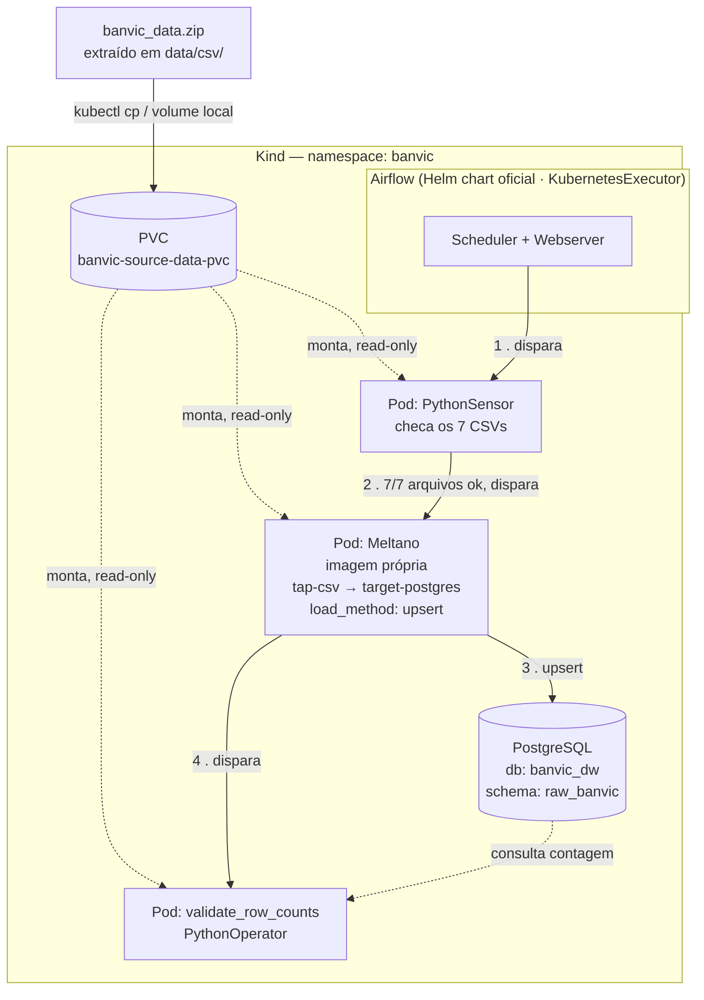

# BanVic — Pipeline de Ingestão de Dados

Pipeline de ingestão das 7 tabelas do ERP do BanVic (`banvic_data.zip`) para um
Data Warehouse simulado em PostgreSQL, orquestrado com Apache Airflow sobre Kubernetes
e executado via Meltano (Singer).

O ambiente inteiro sobe do zero com **um comando** (`make setup`) e a ingestão é
**idempotente**: reexecutar não duplica registros.

## Estrutura do repositório

```
.
├── infra/
│   ├── kind-config.yaml          # Config do cluster Kind (nomes/portas)
│   ├── k8s/
│   │   ├── 00-namespace.yaml
│   │   ├── source-data-pvc.yaml  # PVC dos CSVs de origem
│   │   └── postgres/             # Deployment, Service, PVC, Secret (template)
│   │                              # único destino: ingestão pura (sem MinIO/staging)
│   └── helm/
│       ├── airflow-values.yaml           # Override do chart oficial do Airflow
│       └── airflow-secrets.example.yaml  # Template de segredos do Airflow
├── ingestion/
│   └── meltano/
│       ├── meltano.yml       # Extractor (tap-csv) + Loader (target-postgres) + job
│       ├── Dockerfile        # Imagem própria com o projeto Meltano embarcado
│       └── .dockerignore
├── dags/
│   ├── banvic_ingestion_dag.py
│   └── utils/
│       ├── config.py         # TABLE_SOURCE_MAP (fonte única das 7 tabelas)
│       ├── checks.py         # Checagem de presença dos 7 CSVs (PythonSensor)
│       ├── validations.py    # Checagem de integridade origem x destino
│       └── callbacks.py      # on_failure_callback / monitoramento
├── scripts/
│   └── install-prereqs.sh    # instalacao opcional dos pre-requisitos (WSL/Linux)
├── data/csv/                 # (git-ignored) extrair aqui o banvic_data.zip
├── Makefile                  
├── .env.example
└── requirements.txt
```

## Pré-requisitos

Ambiente de referência: **WSL2 (Ubuntu) ou Linux**. É onde o projeto foi desenvolvido e
validado de ponta a ponta.

| Ferramenta | Versão validada | Para quê |
|---|---|---|
| Docker Desktop (ou Docker Engine) | 29.7.2 | roda o nó do Kind e builda a imagem do Meltano |
| `kind` | 0.24.0 | cria o cluster Kubernetes local |
| `kubectl` | 1.37.0 | aplica os manifestos e acessa o cluster |
| `helm` | 3.22.0 | instala o chart oficial do Airflow |
| `make` | 4.4.1 | orquestra os alvos do `Makefile` |
| `unzip` | — | extrai o `banvic_data.zip` |

Versões próximas devem funcionar; as acima são as efetivamente testadas.

**Se você está no Windows**, rode o projeto de dentro do WSL2, não do PowerShell:

1. [Install WSL](https://learn.microsoft.com/windows/wsl/install) — basta `wsl --install`
2. [Docker Desktop WSL 2 backend](https://docs.docker.com/desktop/features/wsl/) — a
   integração do Docker Desktop com a distro precisa estar **habilitada**, senão o `docker`
   não existe dentro do WSL

Recomendável dar alguma folga de memória ao Docker/WSL.

Para instalar o que falta, há um script **opcional**:

```bash
bash scripts/install-prereqs.sh
```

Ele é idempotente e **não** instala Docker — se o `docker`
não estiver disponível, ele apenas avisa e aponta os links acima para não conflitar com uma
instalação do Docker Desktop.

Um cliente SQL (DBeaver, pgAdmin ou `psql`) é opcional, útil para inspecionar o destino.

## Como rodar

```bash
# 1. Extraia o banvic_data.zip para data/csv/
unzip banvic_data.zip -d data/csv/

# 2. Copie e preencha os templates de segredo
cp .env.example .env
cp infra/k8s/postgres/secret.example.yaml infra/k8s/postgres/secret.yaml
cp infra/helm/airflow-secrets.example.yaml infra/helm/airflow-secrets.yaml

# 3. Comando setup do ambiente
make setup

# 4. Acesse a UI do Airflow: http://localhost:8080
#    O Kind ja publica essa porta (extraPortMappings em infra/kind-config.yaml),
#    entao nao eh preciso tunel. Se precisar de um: make port-forward
```

## Arquitetura da solução



## Decisões de arquitetura

| Decisão | Escolha | Por quê |
|---|---|---|
| Cluster local | Kind | o `extraPortMappings` do próprio `kind-config.yaml` já publica a UI e o Postgres no host sem túnel à parte |
| Executor | `KubernetesExecutor` | não há worker fixo ocupando memória entre execuções e é o que torna o `KubernetesPodOperator` o caminho natural para o pod do Meltano |
| Versão do Airflow | 2.10.5 (chart 1.16.0) | é o default do chart travado; no 3.x o webserver dá lugar a api-server + dag-processor, o que mudaria toda a configuração do Helm |
| Postgres | próprio, não o embutido no chart | o chart aponta para uma imagem Bitnami que saiu do Docker Hub — instalar direto resulta em `ImagePullBackOff` |
| Destino | um Postgres, schema `raw_banvic` | o escopo é 1 fonte → 1 destino; uma camada de staging ou data lake aqui não teria consumidor |
| Idempotência | `load_method: upsert` + `max_active_runs=1` | merge pela chave primária, verificado rodando a DAG duas vezes |

## Estratégia de ingestão

### Por que `tap-csv` e não `tap-postgres`

As 7 tabelas do `banvic_data.zip` chegam como arquivos CSV. `tap-csv` é o extrator direto
para esse cenário, que simula um sistema legado/on-premise entregando extrações em arquivo.

A alternativa avaliada foi carregar os CSVs primeiro num Postgres "legado" e extrair com
`tap-postgres`. Foi **descartada** por adicionar um componente que não existe no problema
real: o desafio é ingestão de 1 fonte para 1 destino e um banco intermediário só existiria
para justificar o uso de um tap diferente. Pelo mesmo motivo não há MinIO nem camada de
staging.

### Por que uma imagem própria do Meltano

A imagem oficial `meltano/meltano` é um runtime vazio: não contém o `meltano.yml` do
projeto nem os plugins instalados. Usá-la direto faria o `meltano run` falhar assim que o
pod subisse, por não haver projeto Meltano algum.

`ingestion/meltano/Dockerfile` resolve isso embarcando o projeto e rodando `meltano install`
em **build-time**, o que também deixa a execução mais rápida (sem instalar plugins a cada
run) e estável: uma vez construída, a imagem carrega versões fixas de tap e target.

A DAG não invoca os plugins soltos: ela chama o job `banvic_full_ingestion`, declarado em
`meltano.yml`. Assim a composição do ELT — quais plugins e em que ordem — fica no projeto
Meltano e a DAG apenas orquestra.

### O problema de tipagem (e por que `schema` sozinho não basta)

CSV não carrega tipo nativo — o `tap-csv` descobre **toda** coluna como `string`. Corrigir
isso exigiu duas peças distintas no `meltano.yml`, e confundi-las é um erro comum:

| bloco | o que faz | o que **não** faz |
|---|---|---|
| `schema:` | anota o tipo declarado no catálogo Singer | não converte o valor dentro do registro |
| `stream_maps:` | converte o valor, registro a registro | não altera o tipo declarado |

Duas particularidades reais dos dados do BanVic que exigiram tratamento:

1. **Datas fora do ISO-8601.** O CSV grava `"2017-04-03 16:11:00 UTC"` com a palavra `UTC`
   por extenso — formato que o `target-postgres` rejeita com `Could not parse value`. A
   expressão faz o parse do formato de origem e reserializa em ISO-8601 real.
2. **Microssegundos inconsistentes.** Algumas linhas trazem `.67516`, outras não, na mesma
   coluna. Por isso a expressão escolhe o formato de parse
   dinamicamente, checando a presença de `.` no valor, em vez de assumir um formato único.

### Como a idempotência é garantida

`target-postgres` roda com `load_method: upsert`, fazendo **merge pela chave primária**
declarada em `keys` de cada entidade. Reexecutar a DAG para o mesmo dia não duplica nada.

Comprovado na prática: a DAG executou duas vezes seguidas sobre o mesmo destino sem
limpeza entre elas (uma run `scheduled` e uma `manual`, ambas em `success`) e as sete
contagens ficaram idênticas.

No nível da orquestração, `max_active_runs=1` complementa: impede duas execuções
concorrentes escrevendo no mesmo destino.

### Volume processado

| tabela | linhas | chave primária |
|---|---|---|
| agencias | 10 | `cod_agencia` |
| clientes | 998 | `cod_cliente` |
| colaborador_agencia | 100 | `cod_colaborador` + `cod_agencia` |
| colaboradores | 100 | `cod_colaborador` |
| contas | 999 | `num_conta` |
| propostas_credito | 2.000 | `cod_proposta` |
| transacoes | 71.999 | `cod_transacao` |

**76.206 registros** no total. `transacoes` sozinha é ~94,5% deles.

Cada tabela recebe também colunas `_sdc_*` para auditoria da carga, de duas naturezas:
**procedência do arquivo** (`_sdc_source_file`, `_sdc_source_lineno`) geradas pelo
`tap-csv`, e **tempos da carga** (`_sdc_extracted_at`, `_sdc_batched_at`) geradas pelo
`target-postgres`.

### Como os dados chegam ao pod

Os CSVs vivem num PVC (`banvic-source-data-pvc`) populado por `make load-source-data`. Ele
é montado **read-only** nos três pods da DAG: o sensor precisa vê-los para checar presença,
o Meltano para extrair e a validação para contar as linhas de origem.

O ponto de montagem não é o mesmo nos três: o sensor e a validação recebem os arquivos em
`/opt/airflow/data`, enquanto o pod do Meltano os recebe em `/project/data`, dentro do
diretório do projeto Meltano.

Com `KubernetesExecutor`, cada task roda em um pod criado a partir do pod template padrão
do chart, que **não** tem esse volume. Por isso, o sensor e a validação usam
`executor_config` (`pod_override`) para montar o PVC em `/opt/airflow/data` — só o
`KubernetesPodOperator` declara volumes diretamente.

Já o `/project/data` vem do environment `k8s` declarado no `meltano.yml` que a DAG
seleciona com `--environment=k8s`.